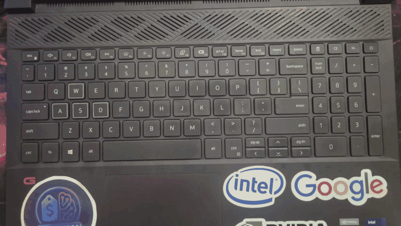

<div align="center">

# ⌨️ dell-g15-keyboard-backlight-solution

**A luz do teclado do seu Dell G15 apagou — no Windows ou no Linux? Este projeto acende de volta e deixa você escolher a cor com um clique.**

[](LICENSE)
[](#-windows)
[](#-linux)
[](#-compatibilidade)
[](#-créditos)
[](#-como-contribuir)
[](https://github.com/gillemosai/dell-g15-keyboard-backlight-solution/stargazers)
[](https://github.com/gillemosai/dell-g15-keyboard-backlight-solution/commits)

[Windows](#-windows) · [Linux](#-linux) · [Compatibilidade](#-compatibilidade) · [Problemas](#-solução-de-problemas) · [English](#-english)

© 2026 **Gil Lemos** · [gillemosai.com](https://gillemosai.com)



</div>

---

## 🤔 O problema

Muitos Dell G15 vêm com teclado RGB controlado por um chip da Alienware (`187c:0550`). Quem cuida dele é o Alienware Command Center (AWCC) — e é comum a luz **apagar depois de uma atualização do AWCC**, obrigando a desinstalar e reinstalar tudo. No Linux não existe nada equivalente instalado por padrão: o teclado fica apagado, a tecla **Fn + F10** não resolve e a luz pode sumir de novo depois de suspender o notebook.

Este projeto fala **direto com o chip do teclado**, sem depender do AWCC. A cor fica gravada no próprio teclado, então você escolhe uma vez e ela continua depois de reiniciar.

## 🪟 Windows

Testado no **Dell G15 5511** com **Windows 11**.

**1.** Baixe este repositório (botão **Code > Download ZIP**) e extraia a pasta.

**2.** Abra a pasta `windows` e dê dois cliques em **`instalar.bat`**. Ele instala a biblioteca necessária (`hidapi`) e cria o atalho **Cor do Teclado** na Área de Trabalho.

> Precisa do [Python 3](https://www.python.org/downloads/) instalado (marque **Add Python to PATH** na instalação). Se não tiver, o `instalar.bat` avisa e abre a página de download.

**3.** **Feche o Alienware Command Center** e abra o atalho **Cor do Teclado**. Escolha a cor — em alguns segundos a luz acende.

**Pelo terminal** (PowerShell, dentro da pasta `windows`):

| Comando | O que faz |
|---|---|
| `python g15_teclado_windows.py` | Abre a janela de cores |
| `python g15_teclado_windows.py --cor 0x00AAFF` | Aplica uma cor (formato `0xRRGGBB`) |
| `python g15_teclado_windows.py --acender` | Liga em branco |
| `python g15_teclado_windows.py --desligar` | Apaga a luz |
| `python g15_teclado_windows.py --diagnostico` | Testa a comunicação e mostra informações para relatar problemas |

Para remover o atalho, use `desinstalar.bat`.

> **Se o AWCC atualizar e a luz apagar de novo,** é só abrir o atalho e escolher a cor outra vez.

## 🐧 Linux

Um instalador que **identifica sozinho** o seu notebook, o sistema e o tipo de luz do teclado, e configura tudo:

- 🔍 **Detecta** o modelo, a distribuição Linux, o gerenciador de pacotes e o controlador de luz
- 🎨 **Atalho "Cor do Teclado"** no menu: abre uma janela com 10 cores prontas + seletor de qualquer cor
- 💾 **Lembra a última cor** e aplica automaticamente ao entrar no sistema
- 😴 **Reaplica a cor ao voltar da suspensão** — a causa mais comum do "apagou de novo"
- 🔐 **Sem senha a cada uso**: cria uma regra de permissão só para o controlador do teclado
- 🩺 **Diagnóstico** com um comando, para relatar problemas
- 🧹 **Desinstalador** que remove tudo o que foi criado

### Instalação

Abra o terminal e rode:

```bash
git clone https://github.com/gillemosai/dell-g15-keyboard-backlight-solution
cd dell-g15-keyboard-backlight-solution
bash install.sh
```

> Rode **sem** `sudo`. O instalador pede a senha só nos passos que precisam.

O instalador mostra o que encontrou e o que vai fazer antes de começar. Exemplo de saída:

```
==> Identificando o notebook
    ✔ Dell Inc. Dell G15 5511
==> Identificando o sistema
    ✔ Zorin OS 17 · kernel 6.8.0 · GNOME
    ✔ Gerenciador de pacotes: apt
==> Procurando o controlador de luz do teclado
    ✔ Teclado RGB com controlador Alienware 187c:0550 (suportado)
```

### Como usar

**Pelo menu:** procure **Cor do Teclado**, escolha a cor e clique em OK.

**Pelo terminal:**

| Comando | O que faz |
|---|---|
| `g15-teclado` | Abre a janela de cores |
| `g15-teclado --cor 0x00AAFF` | Aplica uma cor (formato `0xRRGGBB`) |
| `g15-teclado --auto` | Reaplica a última cor |
| `g15-teclado --desligar` | Apaga a luz |
| `g15-teclado --diagnostico` | Mostra informações para relatar problemas |

Cores prontas: azul, azul claro, ciano, roxo, rosa, vermelho, laranja, amarelo, verde, branco e "desligar luz".

### Desinstalar

```bash
bash uninstall.sh
```

> **Observação (Windows e Linux):** o controlador deixa a luz com metade do brilho quando o notebook está na bateria e pisca em vermelho com bateria baixa. É o comportamento padrão dele.

## 💻 Compatibilidade

| Modelo / controlador | Situação |
|---|---|
| Dell G15 **5511** — RGB `187c:0550` | ✅ Testado no **Linux** (Zorin OS) e no **Windows 11** |
| Outros G15 com RGB `187c:0550` (ex.: 5525) | 🟡 Deve funcionar — usa o mesmo controlador. Conte como foi! |
| G15 com luz **branca** (`dell::kbd_backlight`, sem RGB) | 🟡 Linux: suportado (liga/desliga no brilho máximo). Windows: não suportado |
| G15 **5530** e mais novos — `187c:0551` | ❌ Ainda não suportado (outro protocolo). Alternativa no Linux: AWCC (`awcc-git` no AUR) |

**Distribuições (Linux):** Ubuntu, Zorin OS, Linux Mint, Pop!_OS, Debian (apt) · Fedora (dnf) · Arch, Manjaro (pacman) · openSUSE (zypper).

**Ambientes gráficos (Linux):** GNOME/Zorin (janela via `zenity`) · KDE Plasma (janela via `kdialog`) · sem interface gráfica (menu no terminal).

> A placa de vídeo (NVIDIA, AMD ou Intel) **não interfere** na luz do teclado. O instalador do Linux mostra qual é a sua só para ajudar no diagnóstico.

Não sabe qual controlador você tem? No Linux, rode `lsusb | grep 187c`. No Windows, rode `python g15_teclado_windows.py --diagnostico`: se aparecer `pid=0550`, é este.

## 🩺 Solução de problemas

### Windows

<details>
<summary><b>"Falta a biblioteca" ao abrir o app</b></summary>

Rode `python -m pip install hidapi` (use `python -m pip`, para instalar no mesmo Python que roda o app) e abra o app de novo.
</details>

<details>
<summary><b>"Não consegui abrir o teclado"</b></summary>

Feche o Alienware Command Center. Se continuar, encerre também os serviços Alienware/AWCC em `services.msc` e tente de novo.
</details>

<details>
<summary><b>Não dá erro, mas a luz não acende</b></summary>

Rode `python g15_teclado_windows.py --diagnostico`. O script testa os métodos de comunicação e escolhe sozinho o que o teclado responder (no G15 5511 é o método 2). Se nenhum responder, teste cada um à mão, por exemplo `python g15_teclado_windows.py --metodo 1 --acender`, e [abra uma issue](https://github.com/gillemosai/dell-g15-keyboard-backlight-solution/issues/new?template=relatar-problema.md) com o resultado do diagnóstico.
</details>

<details>
<summary><b>"python" não é reconhecido</b></summary>

O Python não está instalado ou não está no PATH. Reinstale marcando **Add Python to PATH**.
</details>

### Linux

<details>
<summary><b>O teclado não acendeu depois da instalação</b></summary>

Reinicie o computador (para a regra de permissão valer) e abra **Cor do Teclado**. Se ainda não funcionar, rode `g15-teclado --diagnostico` e [abra uma issue](https://github.com/gillemosai/dell-g15-keyboard-backlight-solution/issues/new?template=relatar-problema.md) com o resultado.
</details>

<details>
<summary><b>O atalho da Área de Trabalho não abre</b></summary>

Clique com o botão direito no ícone e escolha **Permitir execução** (ou **Confiar e executar**). Isso só é necessário na primeira vez.
</details>

<details>
<summary><b>Pede senha toda vez que troco a cor</b></summary>

A regra de permissão ainda não foi carregada. Reinicie o computador. Se persistir, confira se o arquivo `/etc/udev/rules.d/60-g15-teclado.rules` existe.
</details>

<details>
<summary><b>Aparece "Este projeto é para o Dell G15"</b></summary>

O instalador não reconheceu o modelo. Se o seu notebook tem o controlador `187c:0550` (confira com `lsusb`), rode `bash install.sh --forcar`.
</details>

## 🤝 Como contribuir

Toda ajuda é bem-vinda, principalmente **relatos de outros modelos**:

1. Instale e teste no seu G15 (Windows ou Linux)
2. Rode o diagnóstico (`g15-teclado --diagnostico` no Linux, `python g15_teclado_windows.py --diagnostico` no Windows)
3. [Abra uma issue](https://github.com/gillemosai/dell-g15-keyboard-backlight-solution/issues) dizendo se funcionou ou não

Pull requests com suporte a novos modelos, distribuições ou traduções também são bem-vindos.

## 🙏 Créditos

**Linux:** a comunicação com o chip do teclado é feita pelo [**G15kblight-cli**](https://github.com/Vescrity/G15kblight-cli), fork do [**Dell-G-Series-Controller**](https://github.com/cemkaya-mpi/Dell-G-Series-Controller) de cemkaya-mpi, baseado no trabalho da comunidade em [trackmastersteve/alienfx#41](https://github.com/trackmastersteve/alienfx/issues/41). Esse controlador é baixado durante a instalação e mantém a licença GPL-3.0 original.

**Windows:** o app em `windows/` reimplementa o mesmo protocolo do controlador `187c:0550` em Python (via [hidapi](https://pypi.org/project/hidapi/)), a partir do trabalho desses projetos. Por ser baseado em código GPL-3.0, o arquivo `windows/g15_teclado_windows.py` deve ser tratado como GPL-3.0.

Este projeto adiciona a detecção automática, o instalador multi-distro, o seletor de cores, a persistência após suspensão, o desinstalador e a versão para Windows.

## 🌎 English

**Dell G15 keyboard backlight not working — on Windows or Linux?** This project talks directly to the keyboard's controller chip (`187c:0550`), without depending on Alienware Command Center. The color is stored in the keyboard itself, so it survives reboots.

**Windows 11:** download the repo, run `windows/instalar.bat` (needs Python 3), close Alienware Command Center and open the **Cor do Teclado** shortcut. Or from PowerShell: `python windows/g15_teclado_windows.py --cor 0x00AAFF`. Use `--diagnostico` if the light does not turn on.

**Linux:** auto-detects your model, distro and backlight controller, installs everything needed and adds a **"Keyboard Color"** app with a color picker. It re-applies your color on login and after suspend, and works without asking for your password each time.

```bash
git clone https://github.com/gillemosai/dell-g15-keyboard-backlight-solution
cd dell-g15-keyboard-backlight-solution
bash install.sh
```

Tested on the G15 5511 (`187c:0550`) on both Windows 11 and Linux. Other `187c:0550` models should work; `187c:0551` (G15 5530+) is not supported yet. Reports and PRs are welcome — the interface is in Portuguese, translations are a great first contribution.

## ⚠️ Aviso

Projeto independente, sem vínculo com a Dell ou a Alienware. Use por sua conta e risco — ele só altera a luz do teclado e pode ser removido a qualquer momento (`uninstall.sh` no Linux, `desinstalar.bat` no Windows).

---

<div align="center">

### Feito por Gil Lemos

Eu traduzo tecnologia e inteligência artificial em soluções práticas — automações, apps e ferramentas para quem quer usar tecnologia sem complicação.

**Conheça meus outros projetos ou fale comigo sobre o seu:**

[](https://gillemosai.com)

Se este projeto te ajudou, deixe uma ⭐ — isso ajuda outras pessoas com o mesmo problema a encontrá-lo.

</div>
